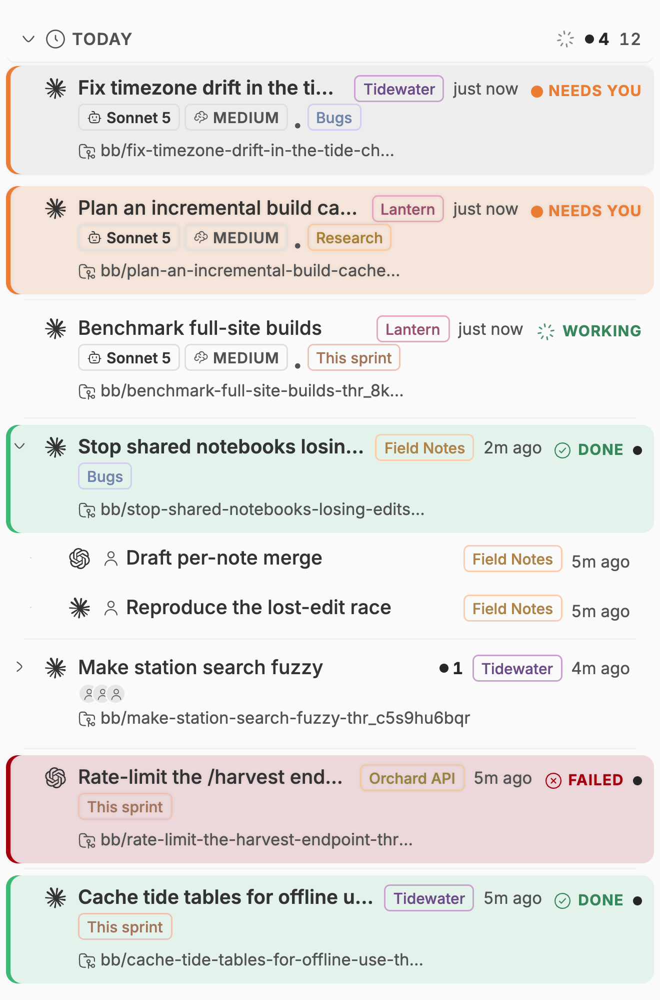
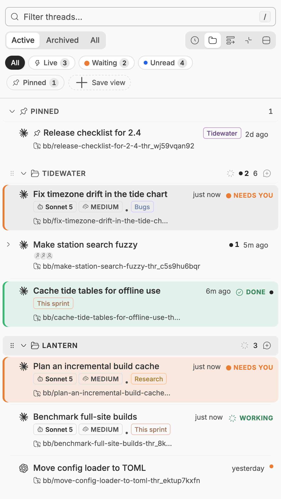
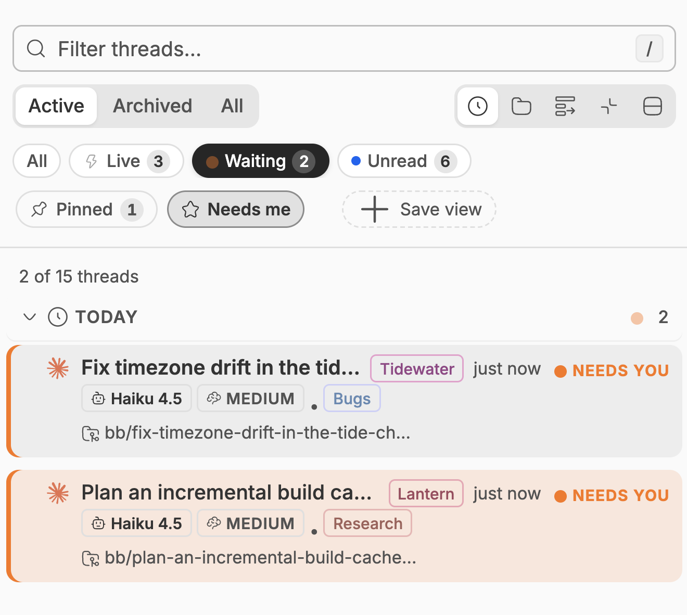
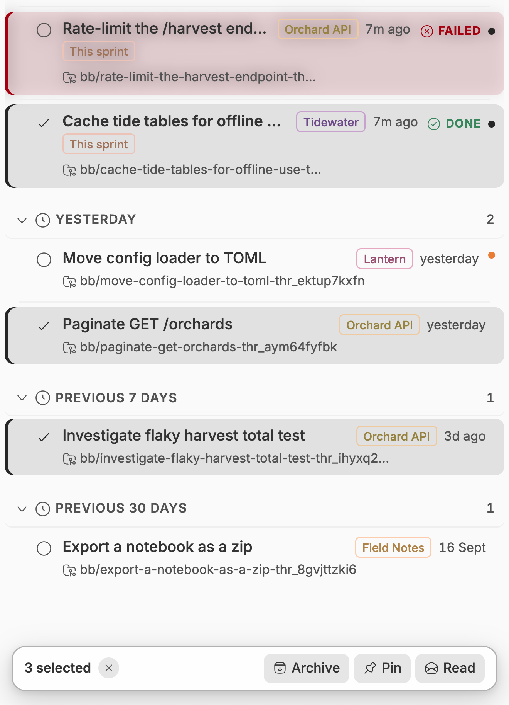
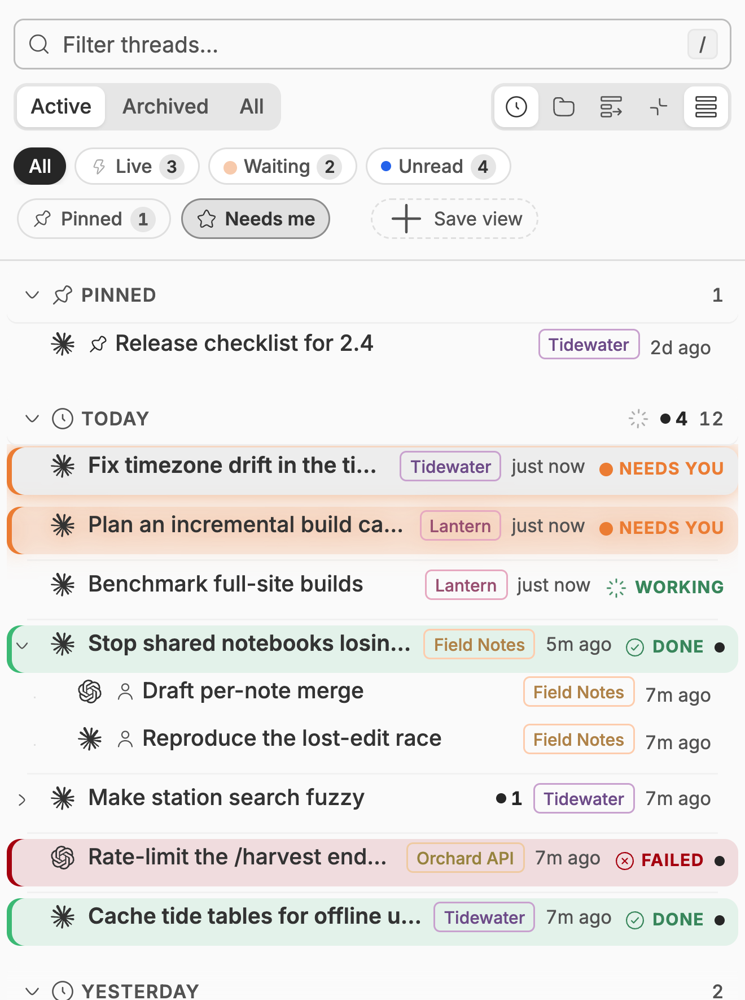
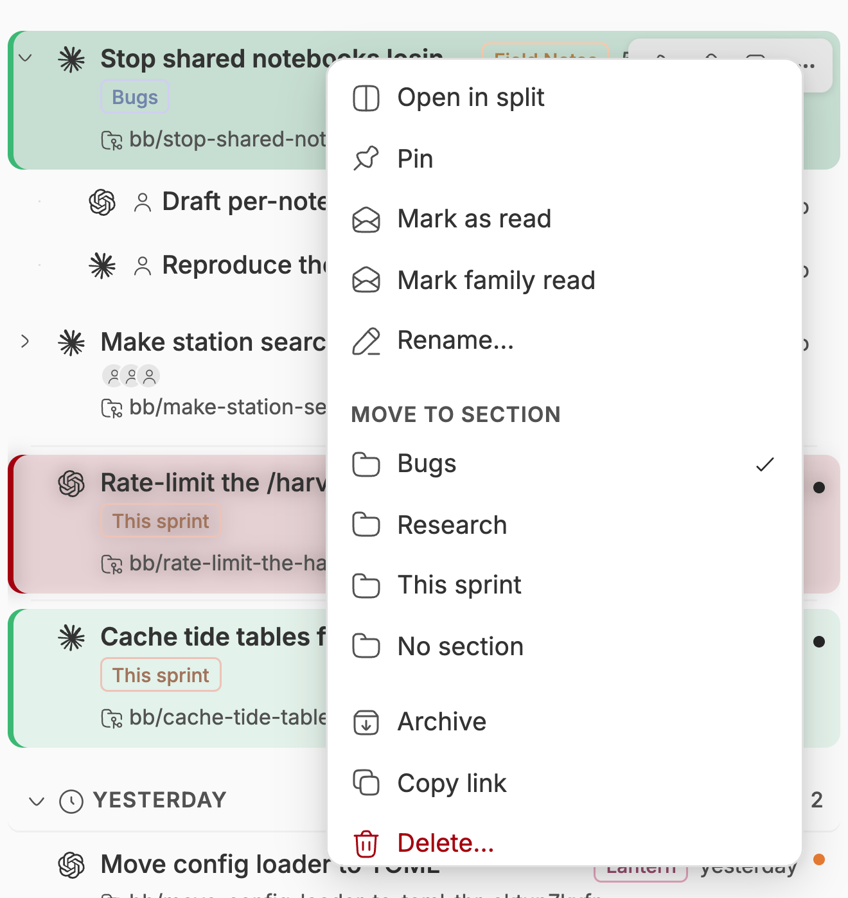
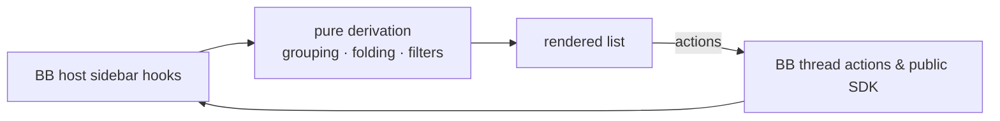

<div align="center">


# Radar Sidebar

### See which of your threads needs you, at a glance.

Radar replaces BB's sidebar thread list with a layout built for people
juggling dozens of agent threads at once.<br>
Grouping, folding and attention states do the sorting for you, so nothing that
needs a decision hides at the bottom of the list.


[Features](#features) · [Install](#install) · [How it works](#how-it-works) · [Settings](#settings) · [Extending Radar](#extending-radar) · [Development](#development)

<br>


</div>

<br>

> [!NOTE]
> The screenshots are real BB captures populated with fictional demo data.

## The problem

You have forty agent threads open across six projects. Two are waiting for a
decision, one failed twenty minutes ago, and three finished while you were
somewhere else. BB's sidebar sorts them all the same way, so finding the ones
that need you is a manual sweep — and the moment you click a thread to look, it
jumps to the top of "Today" and you lose track of what was actually moving.

Radar is opinionated about the difference between *recent* and *important*.
Activity decides where a thread sits, not when you last opened it. Threads that
need something from you are impossible to miss, and threads that are simply
quiet get out of the way.

|  | Without Radar | With Radar |
| --- | :---: | :---: |
| Tell working from finished without reading | ❌ | ✅ distinct icon, word and colour per state |
| Opening a thread changes its group | ❌ it jumps to Today | ✅ grouping keys off real activity |
| See what a collapsed family is hiding | ❌ | ✅ count, unread rollup and loudest state |
| Spot a thread waiting for your input | ❌ | ✅ amber wash, bar and slow pulse |
| Tell which provider and model a thread runs | ❌ | ✅ icon, model and thinking on the row |

## Features

<table>
<tr>
<td width="50%" valign="top">

### 🛰️ Activity grouping

Threads group by Today, Yesterday, Previous 7 days, Previous 30 days or Older,
keyed off last *activity* — not last read. A thread you merely opened stays
where it belongs, and anything running or waiting surfaces to Today. Group by
project or section instead with one toggle. In section view, choose **New
section**, enter a name, then **Create section**. Drag threads onto its header
or use **Move to section** in a thread's right-click menu.

</td>
<td width="50%" valign="top">

### 🔴 Loud attention states

Working, needs-you, failed and finished-unread each get their own icon, status
word, colour and row treatment. Rows that need a decision wash amber or red and
breathe a slow glow; finished-but-unseen threads get a green wash, accent bar
and bold title. Motion is reserved for things that need action, so movement
always means something.

Queued messages scheduled for a future time show a calm clock and **Scheduled**,
with the local run time in the tooltip. Folded families and group headers keep
that distinction. Threads with immediate queued work still show **Queued**.

</td>
</tr>
<tr>
<td valign="top">

### 🪢 Nested families

Child threads sit under their parent with indent guides, and the family sorts by
its freshest activity, so a running child floats its parent. Fold a family and
the summary tells you how many are hidden, how many are unseen, and the loudest
state inside.

</td>
<td valign="top">

### 🔎 Hover peek card

Pause on a row for a preview with the thread's original goal, its branch and
pull request, and a stacked context-window meter marked at the auto-compaction
threshold. It is interactive, so you can pin, split or archive from the card.

</td>
</tr>
<tr>
<td valign="top">

### 🧩 Room for other plugins

Other BB plugins can add bounded badges and menu actions to Radar's rows
through its experimental contribution interface. Turn any one off in Radar's
settings without disabling the plugin. See [Extending Radar](#extending-radar).

</td>
<td valign="top">

### ⌨️ Keyboard and bulk control

Arrow keys walk the list, <kbd>Enter</kbd> opens, <kbd>Space</kbd> folds,
<kbd>E</kbd> archives, <kbd>P</kbd> pins and <kbd>X</kbd> selects. Shortcuts
stay out of text fields, open dialogs and menus, and buttons or links outside the
list, so they never steal keys from the rest of BB. <kbd>⌘</kbd>-click or <kbd>⇧</kbd>-click also selects several,
to act on them together from a floating dock. Save a query plus filters as a
named smart view. Swipe a row, by touch or with two fingers on a trackpad,
to mark it read or archive it; each direction's action is a setting.

</td>
</tr>
</table>

<div align="center">
<table>
<tr>
<td align="center"><br><sub><b>Attention states and nested families</b></sub></td>
<td align="center"><br><sub><b>Hover peek card</b></sub></td>
</tr>
<tr>
<td align="center"><br><sub><b>Grouped by project</b></sub></td>
<td align="center"><br><sub><b>Grouped by section</b></sub></td>
</tr>
<tr>
<td align="center"><br><sub><b>Status chips and a saved smart view</b></sub></td>
<td align="center"><br><sub><b>Multi-select and bulk actions</b></sub></td>
</tr>
<tr>
<td align="center"><br><sub><b>Compact density</b></sub></td>
<td align="center"><br><sub><b>Right-click menu</b></sub></td>
</tr>
</table>
</div>

## Install

```sh
bb plugin install 'git:https://github.com/MacHatter1/bb-plugin-radar-sidebar.git@^0.5.2' --yes
```

The Git semver range tracks compatible `v0.5.x` releases. If you installed
an earlier minor series, rerun this command to move to the new range.

Then pick it in **Settings → Appearance**: choose **Radar** for the sidebar.
On a BB fork with `experimental_navRailSection`, open **Customize rail → Rail
sections** and enable **Radar projects** for compact project tiles below the
navigation icons. The section is independent of the selected thread list.

<details>
<summary><b>Install from a local clone</b></summary>

```sh
git clone https://github.com/MacHatter1/bb-plugin-radar-sidebar
cd bb-plugin-radar-sidebar
npm install && bb plugin build
bb plugin install path:$PWD --yes
```

</details>

**Requirements**

- bb **0.46+** (Plugin SDK 0.6.37+)

## Where to find it

| Where | What |
| --- | --- |
| **Sidebar thread list** | Grouped, folded, attention-coloured threads with a filter, status chips, grouping and density toggles, and expand/collapse all. Status chips fold to glyph and count when the list is 284px or less, so the filter row stays on one line. |
| **Smart views bar** | Saved query-plus-filter presets, and a shortcut to save the current one. |
| **Row hover** | Pin, rename, archive and a fuller menu; a peek card after a short pause. |
| **Settings → Appearance** | Choose Radar for the thread list. |
| **Customize rail → Rail sections → Radar projects** | On supporting BB forks, enable compact project tiles with live badges, project cards, pins and collections. |

## Compatibility notes

Radar replaces only the thread list. BB 0.46 retired the sidebar navigation
replacement. Navigation remains BB's own rail; Radar styles none of BB's elements.
When the host exposes the new `experimental_navRailSection`, Radar also
registers an additive project section. Older hosts skip that registration;
the published SDK minimum stays unchanged. Nothing here bypasses BB's SDK:
archive and delete run BB's own thread actions, other thread operations go
through the public SDK, and client state lives under `radar-sidebar:*`
localStorage keys.

See the [interactive sidebar integration map](docs/radar-sidebar-integration-map.html)
for the thread-list, project-rail and settings extension points.

The optional project section reuses saved project pins and collections. Click
or right-click a tile for its full activity tally, recent threads, Open project,
New thread, pin, read and collection actions. The All projects button finds
projects without active threads too. Drag pinned tiles to reorder them, or use
Move pin up/down in their cards; collection cards expand/collapse, rename and
remove collections. Cards and menus portal outside the rail's scrolling area.
The host controls section visibility/order and keeps it hidden until enabled.

## How it works



- **Reads BB's live state, owns none of it.** Threads, projects and sections
  come from the host's sidebar hooks. Archive and delete run BB's own thread
  actions, so confirmations and undo behave exactly as they do in the stock
  list; pins, read state and renames make the same SDK calls BB's actions do.
- **Derivation stays out of the components.** Grouping, tree building and
  filter matching live in one hook, `useThreadGroups`, and time bucketing is
  a plain function with no React, so the rows only render.
- **Model info is fetched, then cached per window.** The options endpoint
  resolves *defaults*, so model and thinking are shown only while a thread is
  actually in flight. Remounts within the same run reuse cached values;
  new activity, a restart or window focus triggers a refresh.
- **It will not move a thread between projects.** BB's thread API exposes no
  `projectId` on update, so project grouping is view-only; drag-to-organise
  files threads into sections, which BB does allow.

## Privacy

- 🛰️ **No third-party requests.** Radar sends reads and writes only to your BB
  server through the plugin SDK; it contacts no external service.
- 🧾 **Preferences only.** Shared plugin settings live in BB's plugin KV storage.
  Browser `localStorage` holds a first-paint cache and per-client view choices.
  Radar creates no separate database.
- 🔒 **No secrets.** The plugin defines no secret settings and reads none.

## Settings

Open **Settings → Installed plugins → Radar Sidebar**. The plugin keeps its own
settings, shared by every device you use, so they don't appear in
`bb plugin config`.

The settings page groups its switches into three preview cards: Thread rows,
Attention and feedback, and Swipe actions. Each has a small live picture that
changes as you flip its switches; dependent options are greyed out until their
requirement is on. A fourth **Plugin contributions**
card lists plugins supplying thread badges and menu actions, with shared
per-plugin toggles that leave the plugin itself enabled.

<details>
<summary><b>All settings</b></summary>

| Setting | Default | |
| --- | --- | --- |
| `pinnedProjects` | `{}` | Projects kept visible by the optional project-rail section. Reuses pins from the retired rail and preserves them on unsupported hosts. |
| `projectOrganisation` | Empty order and collections | Pin order, collections and collapse state for the optional project section; shared across clients. |
| `disabledContributors` | `{}` | Per-plugin contribution opt-outs, chosen in the Plugin contributions card; saved atomically and shared across devices. |
| `hoverCard` | `true` | Show the hover peek card. |
| `celebrate` | `true` | Pop the check badge once when a thread finishes. |
| `motion` | `true` | Pulse rows that need input or have failed. Also respects `prefers-reduced-motion`. |
| `loudUnread` | `true` | Wash and accent bar on finished-but-unseen threads. Off keeps the icon and pip only. |
| `adaptiveCollapse` | `true` | Fold quiet read-idle rows down to title, project and time. |
| `defaultDensity` | `"comfortable"` | `comfortable` or `compact`. Applies until you change density in the header, which is remembered per client. |
| `twoLineTitles` | `false` | Enable **Two-line titles** to wrap long titles, including mentions, before truncating. Short titles keep their project chip and time beside them when they fit; otherwise metadata wraps below, aligned with the title text. Applies in both densities. |
| `swipeActions` | `true` | Swipe a row left or right to act on it: one finger on a touch screen, two fingers on a trackpad. A trackpad swipe stopped short rests open with its action as a button. A mouse's clicks, drags and Shift+wheel are unaffected. |
| `swipeRight` | `"Mark read / unread"` | Action for a rightward swipe: `Mark read / unread`, `Pin / unpin`, `Archive / unarchive`, `Open in split`, `Rename`, `More actions`, `Delete…` (BB confirms) or `Nothing`. |
| `swipeLeft` | `"Archive / unarchive"` | Action for a leftward swipe, from the same list. |

The list never waits on settings: until they load it uses the defaults above,
except that `defaultDensity` and `twoLineTitles` use the value this client last
saw, so rows paint at their final height. In two-line mode, hover actions sit
on the row's last line of plain text (the subtitle, or the project chip and
time where the subtitle is folded away), so they stay off a wrapped title and
off the PR badge. A row that is only one line tall still has them over the end
of its title, as in one-line mode. They never change the row's layout.

</details>

<details>
<summary><b>Turning it off</b></summary>

```sh
bb plugin disable radar-sidebar
bb plugin enable radar-sidebar
```

`bb plugin remove radar-sidebar` removes the plugin and its settings. Disabling
it returns the sidebar to BB's own list immediately.

</details>

## Extending Radar

Other BB plugins can publish **thread badges and context-menu actions** through
Radar’s experimental v1 contribution interface. BB owns discovery and plugin
lifecycle; Radar owns rendering, accessibility, ordering and failure isolation.
There is no separate loader, DOM injection or shared global registry.

See the [contributor guide](docs/contributions.md), the standalone
[`bb-radar-contributions` contract package](packages/contributions/), and the
[tested Agent Teams adapter](examples/agent-teams-radar.ts). The package is ready
for local packing, not yet published to npm; the adapter is an integration
example, not automatically activated in Agent Teams.

Contributions refresh in bounded batches while the list is mounted. A slow or
malformed contributor cannot replace BB’s core status or break normal thread
actions. Users can turn each contributor off in Radar’s settings.

## Development

```sh
npm install
npm test
npm run typecheck
bb plugin build
bb plugin install path:$PWD --yes
bb plugin dev                      # rebuild and reload on every save
```

```
server.ts               shared settings in plugin KV storage; RPC and realtime, no CLI
app.tsx                 registers the thread-list and settings slots
app.css                 styles on BB theme tokens, behind the radar- prefix
components/radar/       the list, rows, menus, peek card and smart views
components/radar/*.ts   grouping hook, time bucketing, thread actions, model cache
lib/settingsRpc.ts      versioned settings snapshots and atomic per-item edits
lib/swipe.ts            swipe actions and gesture math
lib/contributions.ts    bounded contribution discovery, reads and activation
packages/contributions/ standalone versioned contracts and registration helper
examples/               tested contributor integration adapters
components/storage.ts   one-time migration of codex-sidebar: preferences
components/ui/          vendored BB UI primitives
skills/                 the bundled agent skill
assets/icon.svg         the plugin icon BB shows (bb.branding.icon)
docs/                   logo and screenshots
```

**Tests** cover time bucketing as plain functions, the
rendered list through BB's plugin test harness (`renderSlot` with seeded
sidebar threads), saved-view validation, preference migration, execution-cache
refreshes, completion timers, and render counts, so a sidebar update re-renders
only the rows that changed. Settings tests cover pending edits, stale snapshots,
reconnection and concurrent per-item edits; interaction regressions cover
complete pointer clicks, IME composition and folded queued work.
Static guards over `app.css` cover cascade mistakes
jsdom cannot reproduce.
The test setup uses jsdom's `localStorage` explicitly, including on Node 26,
whose native storage global otherwise shadows it without a backing file.

`PLUGIN_OVERVIEW.md` is the store listing. Keep it in step with
`bb.description` in `package.json`.

## Licence

[MIT](LICENSE)
